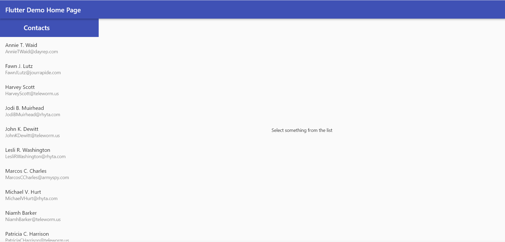
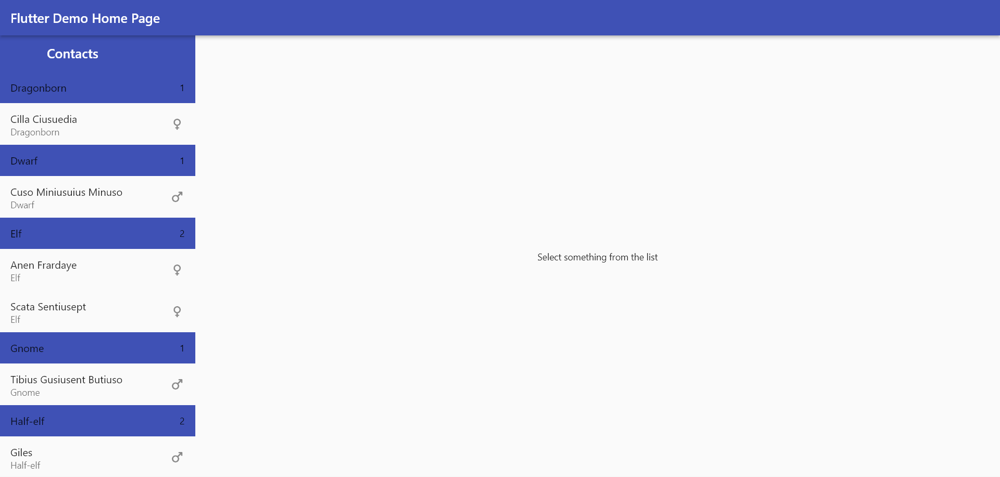
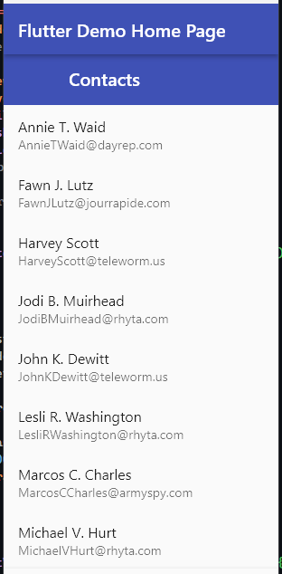
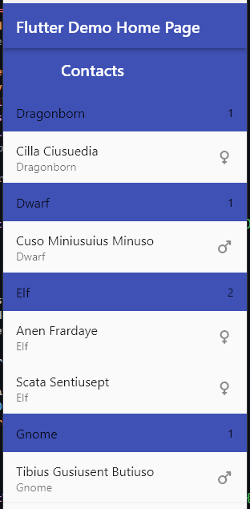

# flutter_master_detail

A Flutter package that simplifies the process of building adaptive master-detail views.

This is a relatively unopinionated package that allows you to customize nearly all aspects of the master detail view in your implementation.

## Getting Started

Import the package:

```dart
import 'package:flutter_master_detail/flutter_master_detail.dart';
```

Use the `MasterDetailsList` widget like any other.

```dart
MasterDetailsList<TElement>( // TElement represents the type of elements that will be present in the `items` parameter.
    items: elementsList, // Mantatory. These elements will be rendered on the master view
    masterItemBuilder: (context, data, isSelected) => {...}, // Mandatory. This determines how the individual elements of the master view will be rendered.
    detailsTitleBuilder: (context, data) => FlexibleSpaceBar(...), // Mandatory. This controls how the title section of the details view.
    detailsItemBuilder: (context, data) => (...), // Mandatory. This controls how the main body of the details section is rendered.
    sortBy: (data) => ..., // Optional. This will be used to sort the elements in the master view while being rendered.
    groupedBy: (data) => ..., // Optional. This will be used to group the list elements while being displayed in the master view. This will also be automatically used to sort the elements of the list before the `sortBy` parameter.
    groupHeaderBuilder: (context, data, itemsCount) => (...), // Optional. You can use this to control how the grouping header will be dispayed. Note that this will not be used if `groupedBy` parameter is not seet.
    title: const FlexibleSpaceBar(...), // Optional. This will be rendered in the title section of the master view.
    masterViewFraction: 0.5, // Optional. This will be used in larger screens. This determines the percentage of viewport width that can be taken up by the master view. Defaults to `0.33333`. Note: The max value is currently capped to 300.
    nothingSelectedWidget: (...), // Optional. This will be used in larger screens. This controls the details view when no element is selected in the master view. Defaults to `Select something from the list`.
    transitionAnimationDuration: ..., // Optional. This determines the duration of the animation for bringing up the details view.
);
```

## Drilling into sub-pages (iOS / macOS Settings style)

*Available from 1.2.0.*

The details pane has its own navigator, so a detail page can open further pages
inside the pane. This is the kind of navigation the iOS and macOS Settings apps
use: **Settings → General → Software Update → Automatic Updates**.

You don't need to turn anything on. Inside `detailsItemBuilder`, push pages with
the regular `Navigator` API and they open in the details pane:

```dart
import 'package:flutter/cupertino.dart';
import 'package:flutter/material.dart';
import 'package:flutter_master_detail/flutter_master_detail.dart';

MasterDetailsList<String>(
  items: ['General', 'Appearance'],
  masterItemBuilder: (context, item, isSelected) =>
      ListTile(title: Text(item), selected: isSelected),
  detailsTitleBuilder: (context, item) =>
      FlexibleSpaceBar(title: Text(item)),
  detailsItemBuilder: (context, item) => Column(
    children: [
      ListTile(
        title: const Text('Software Update'),
        trailing: const Icon(Icons.chevron_right),
        // `context` here is inside the details pane, so the page opens there.
        onTap: () => Navigator.of(context).push(
          CupertinoPageRoute(builder: (_) => const SoftwareUpdatePage()),
        ),
      ),
    ],
  ),
);

class SoftwareUpdatePage extends StatelessWidget {
  const SoftwareUpdatePage({super.key});

  @override
  Widget build(BuildContext context) {
    return Scaffold(
      // An AppBar gets a back button automatically.
      appBar: AppBar(title: const Text('Software Update')),
      body: ListTile(
        title: const Text('Automatic Updates'),
        trailing: const Icon(Icons.chevron_right),
        // Pushing again goes one level deeper, still inside the pane.
        onTap: () => Navigator.of(context).push(
          CupertinoPageRoute(builder: (_) => const AutomaticUpdatesPage()),
        ),
      ),
    );
  }
}
```

### How it behaves

| | Tablet / desktop | Phone |
|---|---|---|
| Pushing a page | Replaces the contents of the details pane. The master list stays visible. | Slides in over the detail page. |
| Back (app bar button, Android back, predictive back) | Goes back one page in the details pane. | Goes back one page, then from the detail page back to the master list. |
| Selecting a different item in the master list | Shows that item's detail page with an empty page stack. | Same. |
| Tapping the selected item again | Goes back to that item's detail page. | — |

### Tips

- **Use a page route that suits your platform.** `CupertinoPageRoute` gives the
  iOS slide and swipe-back gesture. `MaterialPageRoute` uses the platform default.
- **Give pushed pages a `Scaffold` with an `AppBar`** to get the back button for free.
- **Swap the current sub-page** with `Navigator.of(context).pushReplacement(...)`.
- **Return from code** with `Navigator.of(context).pop()`. To go back to the
  item's detail page, use `Navigator.of(context).popUntil((route) => route.isFirst)`.
- **Cover the whole screen**, for example with a full-screen dialog or a login
  flow, by using `Navigator.of(context, rootNavigator: true).push(...)`.
- **Use a `context` from inside the details pane.** Pages open in the pane only when
  the `context` you pass to `Navigator.of` comes from `detailsItemBuilder`, or from
  a widget it builds. If your callback captures a `context` from outside
  `MasterDetailsList`, the page opens full screen on your app's navigator.

See [`example/lib/views/settings.dart`](example/lib/views/settings.dart) for a complete Settings-style example.

## Screenshots

### On Larger screens

##### Without Grouping




##### With Grouping


### On Smaller screens

Without Grouping            |  With Grouping
:-------------------------:|:-------------------------:
  |  


